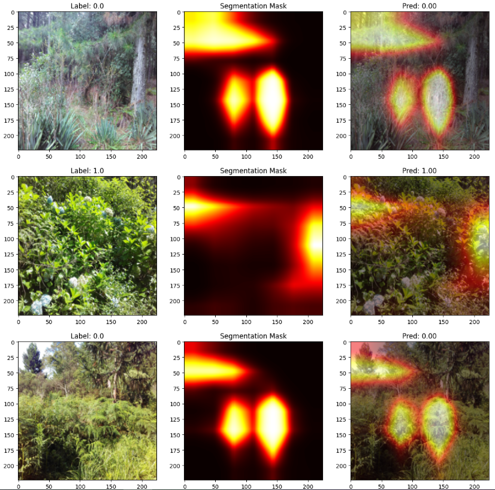

# Invasive Plant Detection

A PyTorch pipeline that classifies whether an aerial image contains invasive plant species, built on the Kaggle [Invasive Species Monitoring](https://www.kaggle.com/c/invasive-species-monitoring) dataset. Instead of feeding raw RGB images straight into a CNN, the pipeline first extracts a texture representation via Sobel-based edge/texture segmentation, then trains a convolutional classifier on that representation. Hyperparameters (optimizer, learning rate, batch size) are tuned automatically with Optuna.

## How it works

1. **Data prep** — Downloads and extracts the Kaggle dataset (images + labels) into Google Drive, for use in a Colab environment.
2. **Texture segmentation** — Converts each image to grayscale and applies Sobel edge detection on both axes to produce a texture/gradient magnitude map, which becomes the model's input channel.
3. **Dataset/loader** — A custom `TextureDataset` resizes, segments, and normalizes images on the fly, with a configurable train/test split.
4. **Model** — A 3-block CNN (Conv → ReLU → MaxPool, channels 32 → 64 → 128) followed by two fully connected layers and a sigmoid output for binary classification.
5. **Hyperparameter tuning** — An Optuna study searches over optimizer type, learning rate, and batch size, using F1 score as the objective and pruning underperforming trials.
6. **Training/evaluation** — Trains with the best-found hyperparameters and reports accuracy, precision, recall, and F1 on the held-out split. The trained model weights are saved and reloaded for evaluation.

## Requirements

- Python 3, PyTorch
- OpenCV (`cv2`)
- pandas, NumPy, scikit-learn
- Optuna
- Kaggle API (`kaggle.json` credentials)
- Designed to run in Google Colab (uses `google.colab.drive` and `google.colab.files`)

## Usage

1. Open the notebook in Google Colab.
2. Upload your `kaggle.json` API credentials when prompted.
3. Mount Google Drive — the notebook downloads, extracts, and caches the dataset there.
4. Run the cells in order: data prep → segmentation → preprocessing → hyperparameter search → training/evaluation.
5. The trained model is saved to Drive and can be reloaded for inference/testing without retraining.

## Results

**Hyperparameter search (Optuna, 27 trials):** the study explored SGD, Adam, and RMSprop across learning rates (1e-4 to 2.5e-3) and batch sizes (32/64/128), pruning weak trials early based on intermediate F1. Many trials collapsed to a degenerate "predict everything as invasive" solution (recall 1.0, precision ~0.63), which pruning helped weed out.

| Trial | Optimizer | LR | Batch Size | Precision | Recall | F1 |
|---|---|---|---|---|---|---|
| **6 (best)** | SGD | 0.0025 | 32 | 0.7147 | 0.9653 | **0.8213** |
| 1 | SGD | 0.0005 | 64 | 0.7107 | 0.9722 | 0.8211 |
| 16 | SGD | 0.0005 | 64 | 0.7348 | 0.9236 | 0.8185 |
| 0 | SGD | 0.0001 | 64 | 0.6992 | 0.9688 | 0.8122 |

SGD consistently outperformed Adam and RMSprop, which tended toward the degenerate solution above.

**Final model performance:**

| Split | Accuracy | Precision | Recall | F1 |
|---|---|---|---|---|
| Training | 0.9793 | 0.9794 | 0.9879 | 0.9836 |
| Testing | 0.8519 | 0.8641 | 0.9113 | 0.8870 |

The gap between training and testing metrics suggests some overfitting on the training split; the texture-based CNN still generalizes reasonably well, correctly identifying invasive plants in held-out images roughly 85% of the time.

**Qualitative results:** sample predictions below show the original image, its Sobel-based segmentation mask, and the mask overlaid on the image alongside the model's prediction. The model correctly classifies both invasive (label 1.0) and non-invasive (label 0.0) samples shown here, with the segmentation mask highlighting the plant regions the texture features are drawn from.

## Notes

- This is a research/experimentation notebook (Colab-oriented), not a packaged library or CLI.
- The segmentation step is a simple Sobel-based texture extractor, not a learned segmentation model — it's used as a lightweight preprocessing/feature-engineering step ahead of the CNN.
